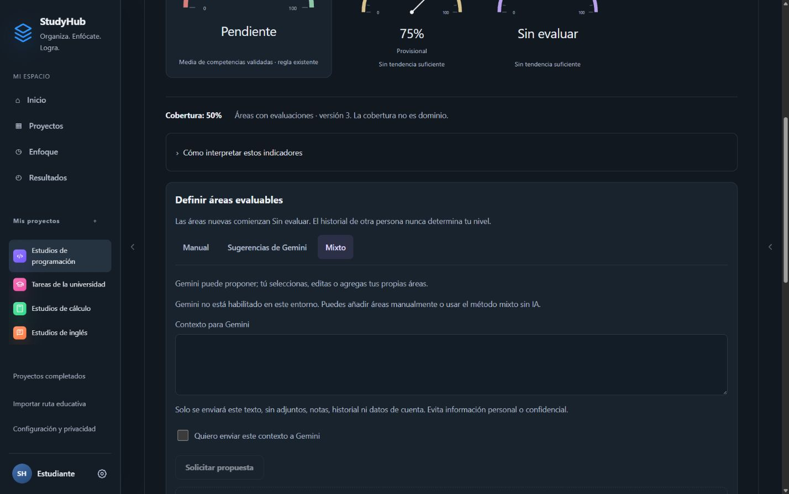

# StudyHub 2.0 — Cierre del candidato de publicación

Fecha de revisión: 27 de octubre de 2026. Rama: `feat/studyhub-2`. Base de este cierre: `bf367c886bb03de84cfacf71821ca3f857de2846`.

Actualización posterior: la verificación local pendiente se ejecutó y se corrigió un conflicto de sincronización. Consultar [Verificación de staging](StudyHub_2_Verificacion_Staging.md) para resultados y condiciones actuales. Este informe conserva el estado histórico del cierre anterior.

El commit final se identifica en la entrega del chat y con `git log -1 --format=%H -- docs/StudyHub_2_Cierre_Candidato.md`. Este informe forma parte de ese commit.

**Recomendación: lista con condiciones para la decisión final de publicación.** La candidata local tiene la funcionalidad pendiente implementada y las comprobaciones descritas abajo superadas. La activación cloud de V2 requiere primero verificar Auth, RLS, Storage, migraciones y proveedores en un entorno independiente. No se recomienda habilitar las banderas de IA ni publicar sin superar esas condiciones.

No se fusionó, publicó ni hizo push. `main` permanece en `4210809303a0dad2825c3bde2324196eda5992a4`. No se utilizaron credenciales reales, datos de producción ni inferencias pagas. La experiencia estable sigue disponible detrás de la misma bandera reversible.

## Funcionalidades terminadas en este cierre

- **Áreas evaluables:** tres métodos en Mi progreso → Competencias: Manual, Sugerencias de Gemini y Mixto. Las propuestas llegan desmarcadas, se pueden editar o retirar y solo se guardan las seleccionadas. Mixto permite agregar áreas propias sin depender de Gemini. El formulario manual existente se conserva.
- **Servicio real preparado:** nueva operación `suggest-areas` en la Edge Function existente, usando `AiEvaluationClient` y el registro durable de solicitudes. Se envía únicamente el contexto escrito explícitamente, con consentimiento en cada envío; no se recopilan notas, adjuntos, identidad, historial ni datos de la cuenta prestada.
- **Recepción protegida:** validación de estructura, límites de tamaño, mensajes comprensibles, cancelación de espera, descarte de respuestas tardías, recuperación con el mismo identificador y prevención de envíos simultáneos duplicados. Una respuesta recuperada no borra las ediciones del usuario ni vuelve a insertar propuestas recibidas.
- **Aceptación atómica:** se reutiliza `StudyHubRepository` mediante `createCompetencies`. Se omiten nombres ya existentes en el mismo proyecto, incluyendo variaciones de mayúsculas y acentos, sin sobrescribirlos. Un error revierte el lote entero. Se registra la versión de cobertura una sola vez por lote aceptado.
- **Procedencia conservada:** cada propuesta mantiene su proveedor, modelo, versión de prompt, identificador de solicitud, contenido original y momento de aceptación, incluso si después se solicita otra propuesta. Un área añadida manualmente no se atribuye a Gemini. No se crea ninguna evaluación ni nivel; comienza Sin evaluar.
- **Borradores:** contexto, propuestas, ediciones y selección persisten por cuenta y proyecto. El consentimiento de envío no se restaura automáticamente. Si no se puede guardar la identidad de la solicitud, se impide enviarla para evitar duplicaciones después de recargar.
- **Accesibilidad y navegación:** foco asociado al formulario y entidad correctos; los formularios desplegados permanecen abiertos durante las actualizaciones. Los paneles compactos aíslan el contenido de fondo, mantienen el recorrido de Tab, cierran con Escape y devuelven el foco. Navegar desde el menú lo cierra y dirige el foco al nuevo contenido.
- **Controles:** rieles laterales de 44 px, búsqueda y enlaces de resultados ampliados a una altura mínima de 44 px; separación de campos y propuestas. Se mantiene la estructura RC1, colores y geometría de los medidores.

La aplicación no muestra resultados simulados cuando faltan servicios: explica la limitación y mantiene disponibles la creación y evaluación manuales. Las respuestas sintéticas están únicamente en pruebas.

## Pruebas y compilación ejecutadas

| Comprobación | Resultado real |
|---|---|
| `npm test` | **187 pruebas correctas, 29 archivos** |
| Base de la entrega anterior | 163 pruebas, 26 archivos; se conservan |
| `npm run build` | Correcto; 88 módulos |
| `git diff --check` | Sin errores de formato |
| Guardas del ejecutor staging | Probadas; la ejecución sin configuración se rechaza antes de acceder a red |
| Consola de la pestaña final | Sin errores capturados |

La compilación mantiene una advertencia de Vite: el archivo JavaScript principal supera 500 kB minificado (aproximadamente 515 kB; 141 kB comprimido). No impide compilar, pero conviene medir la carga en un móvil real antes de publicación. No se alteró la arquitectura ni se ocultó esa advertencia.

Las pruebas nuevas cubren selección explícita, edición, deduplicación concurrente, lote atómico, aislamiento de borradores, procedencia de solicitudes distintas, cancelación/respuesta tardía, bloqueo sin almacenamiento, permisos de envío y recuperación de propuestas. También ejercitan el manejador completo de la función con transporte simulado: dos proveedores concurrentes, éxito parcial, respuesta cacheada, fallo del registro durable y bloqueo de código privado.

Las pruebas conservadas vuelven a comprobar un intento con varias revisiones, conservación histórica, migración idempotente y reversión exacta, recarga, copias, privacidad, cola offline, conflictos, adjuntos, recurrencias, tareas, proyectos y reflexiones. Estas pruebas de contrato **no equivalen** a ejecutar RLS o inferencias contra un servidor.

## Recorridos de navegador ejecutados

Se usó Chrome en Windows con `localPreview=workspace`, datos sintéticos aislados y tamaños CSS de 320, 390, 740, 1024 y 1440 px. No se accedió a una cuenta cloud.

- **30 mediciones finales:** Inicio, Proyecto, Progreso/Ejercicios, Enfoque, Resultados y Áreas/Mixto en los cinco tamaños; ninguna presentó desbordamiento horizontal global. Registro: [candidate-responsive-checks.json](studyhub2/candidate-responsive-checks.json).
- Mixto → agregar área propia → escribir → recargar → recuperar borrador → seleccionar → guardar: área creada Sin evaluar, sin modificar el 75% provisional de la competencia de prueba anterior.
- Formulario Registrar ejercicio abierto → abrir Agenda: el formulario permanece abierto.
- Agenda → abrir tarea → Sin límite → Iniciar → escribir notas → Pausar → Detener → guardar reflexión con los dos campos opcionales vacíos → recargar: **7 segundos**, una sesión nueva y su reflexión conservadas; total previo 10 s + nueva sesión 7 s = **17 s**.
- Historial muestra Sesión 1 y Sesión 2. Completar con otra reflexión válida conserva los 17 s, marca Completada y retira la tarea de la agenda pendiente. La nueva reflexión aparece en el historial.
- Agenda a 320 px: calendario con celdas de al menos 44 × 44 px y desplazamiento horizontal interno, sin ensanchar la página. Tab/Shift+Tab permanece en el panel; Escape devuelve el foco a Agenda. Menú móvil → Resultados cierra el panel.
- Búsqueda y enlaces de resultados medidos con 44 px de altura después de corregirlos.

Las mediciones de tamaño y recorridos de teclado no constituyen una certificación completa WCAG. **No se ejecutaron pruebas en móvil físico ni con NVDA/VoiceOver.** Tampoco se probó cada combinación de navegador, zoom y entrada táctil.



## Integración: ejecutado y pendiente

| Área | Ejecutado | Pendiente externo |
|---|---|---|
| Gemini y Cloudflare | Adaptadores y manejador con HTTP simulado; concurrencia, fallos parciales, caché, cancelación y validación | Invocación con modelos y claves de staging autorizados; disponibilidad, cuota y latencia reales |
| Identidad del intento | Pruebas del repositorio: una entrega, varias revisiones; sin promedio automático | Guardar y recuperar el mismo caso en Supabase aislado |
| Historial/migración | Compatibilidad, conservación de originales, copia verificable, conversión idempotente y reversión en pruebas | Aplicar SQL y verificar ida/vuelta en Postgres aislado |
| Auth y RLS | Contratos de aislamiento y bloqueo de cliente; revisión de las políticas existentes | Ejecutar con dos cuentas sintéticas contra Auth/PostgREST reales |
| Adjuntos | Contratos de carga, reemplazo, descarga y limpieza existentes | Bucket privado, firma, descarga y rechazo de acceso cruzado en Storage real |
| Sincronización | Pruebas de caché, cola offline, revisión y recuperación existentes | Dos clientes reales, desconexión/reconexión y conflicto de revisiones en staging |
| Accesibilidad | Teclado, foco, nombres, estados y tamaños en Chrome | Lector de pantalla y móvil físico |

**No existe staging operativo en esta sesión.** No hay variables `STUDYHUB_STAGING_*`, no están disponibles los ejecutables de Supabase CLI/Deno y Docker Desktop no tiene su motor Linux activo. Se comprobó de nuevo al cerrar. No se reutilizó el enlace remoto del repositorio ni se buscaron claves de producción.

## Verificación de staging preparada

El ejecutor [verify-local-staging.mjs](../scripts/verify-local-staging.mjs) admite exclusivamente `http://127.0.0.1:54321`, requiere una confirmación de entorno desechable y claves locales específicas, y no carga `.env` ni credenciales vinculadas. Rechaza destinos remotos, otro puerto, credenciales dentro de URL y rutas/query inesperadas. **No ejecuta inferencias.**

Cuando exista ese entorno, el ejecutor crea dos usuarios sintéticos y comprueba:

1. Inicio de sesión y rechazo de lectura, escritura, borrado y cambio de propietario entre cuentas; bloqueo anónimo.
2. Snapshot con dos registros históricos separados y un intento con dos revisiones sintéticas; migración, guardado y reversión del snapshot; rechazo de una revisión antigua.
3. Bucket privado; carga, reemplazo y lectura propios; rechazo de descarga, firma, carga y borrado ajenos; firma autorizada del propietario.
4. Registro de solicitudes inaccesible para el cliente, función de reserva exclusiva del servidor, dos reservas concurrentes, recuperación cacheada, conflicto de contenido, reintento fallido y aislamiento por cuenta.
5. Limpieza limitada a los archivos y usuarios sintéticos creados por esa invocación; cualquier fallo se informa.

Este ejecutor está preparado y sus guardas/fixtures están probadas. **La ejecución de integración de ese script no se declara aprobada: falta el servidor local.**

Acciones concretas pendientes para ejecutarlo, sin tocar producción:

1. Iniciar Docker Desktop y disponer de Supabase CLI oficial. Crear una carpeta nueva y desechable, por ejemplo `.tmp/studyhub-staging`, distinta del directorio Supabase vinculado. Ejecutar `supabase init` dentro de esa carpeta. No usar `supabase link`, `--linked`, `db push` ni referencias remotas.
2. Copiar únicamente `supabase/migrations/*.sql` y `supabase/functions/studyhub-evaluate/` de esta rama al nuevo proyecto local. Conservar el `config.toml` generado localmente y un `project_id` exclusivo como `studyhub-staging`. No copiar `.temp`, `.env`, secretos ni datos reales. Ejecutar allí `supabase start`; debe aplicar las migraciones por orden.
3. Obtener las claves **generadas por esa instancia local** y definirlas solo en la sesión de terminal destinada a la prueba:

```powershell
$env:STUDYHUB_STAGING_CONFIRM = 'disposable-local-only'
$env:STUDYHUB_STAGING_URL = 'http://127.0.0.1:54321'
# Asignar STUDYHUB_STAGING_ANON_KEY y STUDYHUB_STAGING_SERVICE_KEY
# con los valores de la instancia local; nunca copiarlos al repositorio.
node scripts/verify-local-staging.mjs
```

El comando final se ejecuta desde la raíz del repositorio. Para aprobar la prueba debe terminar con código cero y `status: passed`, incluyendo limpieza correcta. Si algo falla, conservar el diagnóstico sin claves y corregir antes de activar V2 cloud.

4. Probar la función en ese entorno con `supabase functions serve studyhub-evaluate`, manteniendo verificación JWT. Validar primero errores de configuración sin claves de proveedores. Las pruebas de inferencia **siguen requiriendo autorización expresa**, claves de un entorno separado y límites acordados; no están incluidas en el ejecutor. Consultar la disponibilidad real de los modelos antes de usar los valores configurados.
5. Para probar la migración SQL sobre datos previos, usar una segunda instancia desechable con las migraciones iniciales, cargar solamente fixtures, exportar un dump verificable, aplicar `202610230001` y `202610250001`, comparar colecciones/identificadores y restaurar el dump en otra instancia vacía. Esta verificación de SQL/dump no se sustituye por la prueba JavaScript de reversión.
6. Realizar el recorrido con dos clientes de staging: cambios concurrentes, offline/reconexión, restauración de cola y aislamiento al cambiar de cuenta. Guardar los resultados de esas pruebas y del lector de pantalla/móvil antes de decidir publicación.

El procedimiento sigue el [flujo local oficial de Supabase](https://supabase.com/docs/guides/local-development/cli-workflows). Las sugerencias utilizan la modalidad de [salida estructurada de Gemini](https://ai.google.dev/gemini-api/docs/structured-output), con validación adicional de la respuesta en servidor y cliente.

## Datos, migración y compatibilidad

- No cambia `schemaVersion: 2` ni se fuerza una migración al abrir la aplicación.
- `competencies[].creationSource` es metadata aditiva. Las áreas manuales históricas continúan siendo válidas sin ese campo. Los adaptadores y copias conservan los campos adicionales.
- `aiRequests` incorpora el tipo `area-suggestions`; no se introduce una revisión de competencia ni una calificación. El contexto enviado no se añade al registro de uso; el borrador local conserva el texto para poder recuperarlo.
- El registro durable existente guarda la respuesta JSON de áreas como completada, igual que una evaluación correcta, sin requerir una nueva tabla o relajar RLS.
- La migración histórica de intentos mantiene su versión y copia previa. No fusiona registros por parecido, fecha o ejercicio. La reversión automática se bloquea cuando existen modificaciones posteriores para evitar pérdida de información.
- Reversión visual: desactivar `workspaceV2` dentro de esta misma rama. Reversión de IA: dejar ambas banderas de compilación en `false`. Conservar registros de solicitudes y copias; no borrar tablas como parte de una reversión visual.
- Convivencia con clientes anteriores: la interfaz estable de esta rama puede conservar los campos adicionales, pero un cliente antiguo publicado no interpreta todas las reglas de intentos. Evitar mezclar versiones antiguas y nuevas sobre la misma cuenta hasta verificar esa convivencia en staging.

## Conservación y riesgos restantes

Se mantiene la matriz contractual de [la entrega anterior](StudyHub_2_Entrega_Implementacion.md#matriz-de-conservación). Este cierre reutiliza sus comandos, selectores y adaptadores; no elimina ni reescribe CRUD, proyectos completados/reapertura, recurrencias, fecha/hora, temporizadores, sesiones, reflexiones editables, imágenes, adjuntos, importaciones, copias, informes, entregables, autenticación, sincronización ni evaluaciones históricas. La batería completa que cubre esos grupos volvió a ejecutarse.

No se identificó una nueva exposición de credenciales ni una relajación de permisos en estos cambios. Esto no certifica la configuración real de Supabase, que no se consultó. Las propuestas son datos no confiables y se muestran escapadas. La API solo recibe contexto explícito, pero el usuario debe evitar escribir datos sensibles en él.

Cancelar la espera no garantiza que el proveedor interrumpa una inferencia ya recibida. El registro durable y la recuperación del mismo identificador evitan iniciar otra solicitud equivalente; si el servidor queda en procesamiento sin poder confirmar su guardado, se bloquea el reintento hasta revisar ese registro. No se añade un vencimiento automático que pudiera cobrar dos veces.

Quedan pendientes por dependencia externa: ejecución real de staging, inferencias autorizadas y pruebas con móvil físico/lector de pantalla. No quedan botones decorativos para la nueva funcionalidad: cuando falta configuración, los envíos se deshabilitan con explicación y la vía manual permanece disponible.

## Cómo probar la candidata

```powershell
git switch feat/studyhub-2
npm ci
npm test
npm run build
npm run dev -- --host 127.0.0.1 --port 5174 --strictPort
```

Abrir [la vista previa aislada](http://127.0.0.1:5174/?localPreview=workspace#/home). Usa almacenamiento local separado; no copia una cuenta real ni activa servicios remotos. En un proyecto de Estudios, entrar en Mi progreso → Competencias → Mixto, agregar un área, editarla, recargar y seleccionar antes de guardar. Revisar después Enfoque, Historial, Agenda, Resultados y Configuración.

Para habilitar sugerencias únicamente después de aprobar staging: configurar en el servidor `GEMINI_API_KEY` y un `GEMINI_MODEL` disponible, y compilar ese entorno con `VITE_WORKSPACE_AI_V2_READY=true` y `VITE_WORKSPACE_AREA_SUGGESTIONS_READY=true`. Ninguna clave privada debe tener prefijo `VITE_`. Ambas banderas permanecen en `false` en la plantilla entregada.

La candidata queda preparada para revisión y decisión, **sin fusión ni publicación**. La condición de salida para producción es una pasada satisfactoria de staging y de las comprobaciones externas indicadas, seguida de la aprobación final del usuario.
