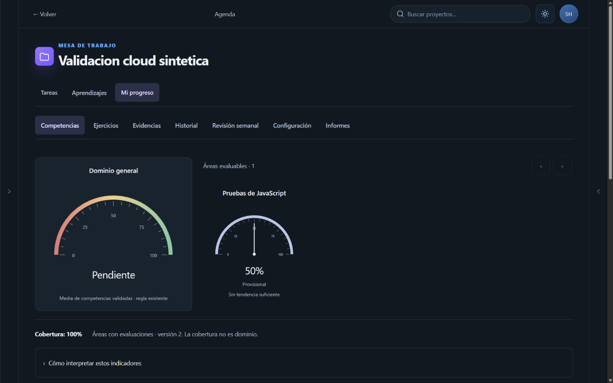
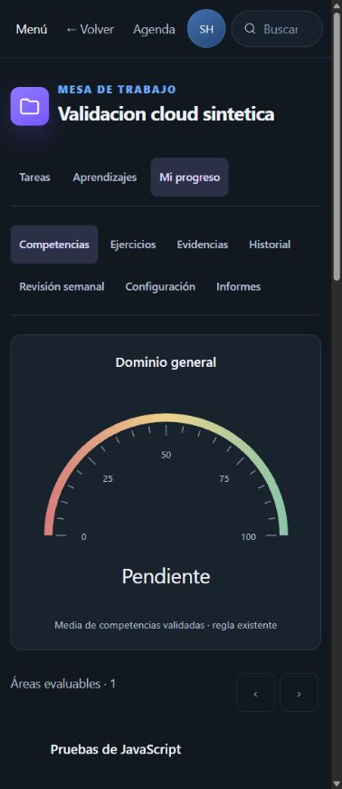

# StudyHub 2.0 — Cierre de validación cloud

Actualización del 29 de octubre: ver [Cierre de pruebas de IA real](StudyHub_2_Cierre_IA_Real.md). Este informe conserva la evidencia histórica del día 28; los pendientes de registro, handler y proveedores se actualizan en ese nuevo cierre.

28 de octubre de 2026 · Rama `feat/studyhub-2`.

**Veredicto: lista con condiciones para decidir una publicación con IA deshabilitada. No está aprobada todavía la activación de proveedores reales.** La infraestructura cloud, los datos y la interfaz manual se comprobaron en un proyecto independiente. No se realizó merge, push ni despliegue de StudyHub en Netlify, ni se utilizaron usuarios, archivos o claves de producción.

El commit exacto de esta entrega es el último que modifica este informe: `git log -1 --format=%H -- docs/StudyHub_2_Validacion_Cloud_Final.md`. Base de este trabajo: `8c28a963d884726dae5e4a6018e9c49b83770041`. `main` se conserva en `4210809303a0dad2825c3bde2324196eda5992a4`.

## Entorno realmente configurado

- Supabase **StudyHub Staging V2**, referencia `uchsgbpohigrtwpsxlnx`, región us-east-1, organización FREE y tamaño NANO observados en el panel. El usuario confirmó la creación y la contraseña. No se contrató un plan de pago.
- Proyecto inicialmente vacío, sin tablas públicas. Se aplicaron, exclusivamente allí y en orden, las migraciones `202609160001`, `202609210001`, `202610230001` y `202610250001` mediante SQL explícito con referencia permitida. No se utilizó `supabase link` ni `db push`. Esta aplicación por SQL no debe confundirse con un registro automático en el historial de migraciones de CLI.
- Auth, tabla de snapshots con RLS, bucket privado `studyhub-task-files`, registro durable de solicitudes y cuota diaria disponibles en el servicio gestionado.
- Función `studyhub-evaluate` desplegada **solo en staging**, con el handler real y un transporte de proveedor sintético que impide llamadas a servicios externos. El paquete temporal exige esa referencia exacta y claves ficticias. No es un paquete publicable en producción.
- Se instaló y probó allí la transición opcional `supabase/transitions/enable_snapshot_cas.sql`. La barrera queda activa; los clientes anteriores no pueden escribir directamente la tabla.
- Interfaz V2 ejecutada temporalmente en `127.0.0.1:5175`, contra ese staging, con RPC de snapshots activada y las dos banderas de IA deshabilitadas. No se cambió la configuración de producción.
- CLI 2.122.0 autenticada mediante el flujo oficial. Las claves de staging se pasaron en memoria a los procesos; no se incluyen en los informes ni en Git.

## Resultados comprobables

| Comprobación | Resultado y alcance |
|---|---|
| Suite automatizada | **202/202**, cero fallos; línea base de la entrega anterior: 194. |
| Supabase cloud | **30 comprobaciones correctas**, incluidas las del handler gestionado; ver `studyhub2/cloud-staging-results.json`. |
| Transición e historial | **13 comprobaciones correctas**, incluidas siete de sincronización con RPC; ver `cloud-transition-results.json`. Hay solapamiento con la suite anterior: no sumar como pruebas únicas. |
| Reversión de la barrera SQL | **5 comprobaciones correctas**; `cloud-gate-reversal-results.json`. Restaurar permisos, leer historial, escribir con el cliente nuevo, reactivar barrera y rechazar al antiguo. |
| Compilación de producción | Correcta: 88 módulos; última compilación 3,05 s en esta máquina. |
| Formato | `git diff --check`; sin errores de espacios. No existe un script de lint/formateo integral en este proyecto. |
| Secretos | Escaneo por patrones de archivos versionables y `dist`, incluidos mapas de fuentes, sin hallazgos. No equivale a una garantía contra cualquier secreto posible. |
| Pantallas | Medidas DOM en 320, 390, 740, 1024 y 1440 px CSS: sin desbordamiento horizontal de documento en las vistas examinadas. |

Las salidas sanitizadas se guardan en `docs/studyhub2/cloud-*.json`. `cloud-environment-final.json` confirma cero usuarios sintéticos, cero snapshots, cero archivos y barrera activa al cierre, y conserva los hashes de las cuatro migraciones. Los checks de red utilizan el Supabase gestionado real. La conectividad offline y el almacenamiento de navegador de los dos clientes de integración se controlan en memoria: son HTTP y repositorios reales con una desconexión simulada, **no** una prueba de desconexión física de dos dispositivos.

### Auth, RLS y Storage

Se crearon dos cuentas sintéticas mediante la API administrativa de staging, se inició sesión por contraseña y se cerraron sus sesiones. Se verificaron lecturas, escrituras, borrado y cambio de propietario entre cuentas; los accesos cruzados y anónimos quedaron rechazados. El servicio de solicitudes no es accesible directamente desde el cliente.

Storage privado permitió subir, descargar, sustituir, firmar temporalmente y eliminar el archivo propio. La segunda cuenta no pudo leerlo, enumerarlo, firmarlo, sustituirlo ni eliminarlo. Los datos y archivos de las ejecuciones se limpiaron. La cuenta sintética de la revisión visual también fue eliminada después de comparar sus datos con la copia exportada.

**Registro público pendiente:** se hizo una solicitud real `signUp` con un correo del dominio reservado `example.test`. Supabase devolvió HTTP 400, `email_address_invalid`. Por tanto, la prueba no acredita registro público ni entrega de correo. Falta un buzón de pruebas válido autorizado y, si el correo predeterminado no permite ese destinatario, SMTP de pruebas. No se desactivó la confirmación de email para aparentar una aprobación. Evidencia: `cloud-registration-results.json`.

### Concurrencia, historial y reversión

Dos clientes con el mismo usuario compitieron por una revisión: ganó uno; el otro conservó su cola y mostró conflicto. Recargar no destruyó esa cola. Se probaron reanudación, carga de cambios del segundo cliente, recuperación explícita y confirmación de escritura perdida sin duplicar datos.

La copia previa a la conversión contiene snapshots **sintéticos**, se guardó en archivo y se verificó con SHA-256. La conversión preservó evaluaciones antiguas por separado y un intento con dos revisiones. Después se restauró la copia y se comparó su contenido. El hash exacto está en `cloud-transition-results.json`; la revisión de escritura se incrementa al restaurar, evitando retroceder el contador CAS.

La reversión probada es de datos de snapshot y de permisos de la barrera. **No es una restauración completa del esquema de producción ni de sus archivos.** El backup de producción y su ensayo de recuperación seguirán siendo requisito previo a una publicación autorizada.

### Edge Function gestionada

Se comprobaron JWT real y falsificado, identidad de usuario, respuestas almacenadas, caché separada por cuenta, concurrencia, idempotencia, cambio de contenido con igual identificador, reintento, cancelación de espera con recuperación tardía, fallo parcial, propuestas sintéticas, cuota y tamaño. La respuesta inválida con puntuación 99 se rechazó y no se convirtió en una evaluación válida.

El gateway gestionado con las claves asimétricas del nuevo proyecto no se comportaba igual que el runtime local. El handler ahora valida la sesión contra `/auth/v1/user` también para consultas de configuración y llamadas antiguas. El paquete de staging usa `verify_jwt=false` en su configuración temporal **manteniendo esa verificación obligatoria en el handler**. El archivo de configuración estable no se modificó. Antes de publicar se debe elegir y probar la combinación de gateway/firma adecuada, sin omitir la validación del usuario. Referencias: [autenticación de funciones](https://supabase.com/docs/guides/functions/auth) y [migración de claves](https://supabase.com/docs/guides/getting-started/migrating-to-new-api-keys).

Las inferencias se sustituyen exclusivamente en el transporte de pruebas. La validación, Auth, SQL, almacenamiento durable y ejecución gestionada son reales; **la calidad de Gemini/Cloudflare, sus latencias, consumo y formato efectivo no se han validado con inferencias reales**.

## Correcciones realizadas

1. Las cuentas cloud nuevas empiezan vacías. Ya no reciben automáticamente proyectos, tiempo o resultados del ejemplo local. No se borraron ejemplos ni datos de cuentas existentes.
2. Validación de Auth en todas las acciones protegidas del handler, incluida configuración y clientes antiguos.
3. Límite de 256 KiB antes de parsear solicitudes; rechazo de JSON inválido, acciones/proveedores/perfiles desconocidos y rúbricas vacías o con criterios repetidos. Se valida la evidencia antes de reservar o llamar a un proveedor.
4. Respuestas de evaluación requieren exactamente los criterios solicitados, puntuaciones numéricas 0–4 y campos del contrato. No se reparan ni promedian resultados inválidos.
5. Las llamadas antiguas pasan también por la cuota durable por cuenta. Reciben un identificador del servidor y conservan el formato de respuesta. No tienen idempotencia entre reenvíos sin identificador estable; para eso deben actualizar el cliente. Si falta la infraestructura durable, se falla antes de inferir.
6. Gateway opcional de snapshots por RPC, sin fallback a escritura insegura. SQL de activación y reversión separados de migraciones automáticas.
7. Controles de nueva tarea, modo del reloj, selección de archivos e imágenes ampliados a 44 px; campos invisibles conservan su tamaño accesible de 1 px. Calendario de Agenda mantiene columnas de 44 px con desplazamiento interno cuando no caben.
8. Herramientas de staging con referencia fija y consentimiento explícito de entorno desechable. Los scripts PowerShell requieren versión 7; se evita el problema de expansión de argumentos de `npm.ps1` usando `npm.cmd`.

No se cambió la fórmula de dominio, el modelo de intento, los colores por competencia, la arquitectura del repositorio ni la interfaz estable.

## Recorridos de interfaz contra cloud

Se ejecutaron creación de proyecto y tarea, temporizador sin límite, pausa, recarga, conservación del borrador, detener y guardar reflexión con campos opcionales vacíos, completar y consultar historial. Resultado contrastado con la nube: **1 sesión cronometrada de 1 segundo y 2 reflexiones**, sin duplicar ese segundo al completar sin tiempo nuevo.

También se comprobaron Agenda por hacer/completadas, calendario, competencia manual con borrador que sobrevive a recarga, ejercicio, revisión manual, historial, medidor provisional, recomendación convertida en tarea y cierre de sesión. La revisión sintética fue 50% provisional, con dominio general Pendiente: no se certificó una competencia.

Se descargaron Markdown, informe JSON y copia JSON. La copia se comparó con las colecciones reales del usuario de staging: proyectos, tareas, sesiones, reflexiones, competencias, ejercicios y evaluaciones coinciden. Sus tamaños y hashes están en `cloud-ui-results.json`.

La restauración desde el selector de archivos del navegador quedó bloqueada por la extensión: requiere **Chrome → Extensiones → ChatGPT → Detalles → Permitir acceso a URLs de archivo**. No se declaró aprobada. La carga/descarga privada y la restauración por backend sí se comprobaron por separado. Esto también limita repetir adjuntos e importaciones mediante el selector UI en esta ejecución.

Con IA deshabilitada se observó el aviso de Gemini no habilitado y se mantuvo el método manual. Aceptar/editar propuestas obtenidas de un proveedor real y comparar sus respuestas quedan pendientes junto con las inferencias autorizadas; sus contratos tienen pruebas automatizadas y de transporte sintético, no una aprobación real de proveedor.

### Accesibilidad y rendimiento

- Cinco anchos medidos en configuración, proyecto, Enfoque, Agenda/calendario, competencias e historial. Se revisaron los controles visibles del viewport y sus etiquetas pulsables; esto no acredita cada control oculto o estado posible de toda la aplicación.
- Teclado: Tab entre secciones y foco visible comprobados. Cancelar formulario y volver a la tarea comprobados; no se declara una auditoría completa de teclado/diálogos.
- Regla `prefers-reduced-motion` conservada e inspeccionada en CSS. No se ejecutó una prueba del ajuste del sistema operativo.
- Colores y contraste visual conservados; falta una auditoría instrumental exhaustiva de todas las combinaciones/estados.
- **Pendientes:** móvil físico y NVDA/VoiceOver. El cambio de viewport en Chrome no los sustituye.
- JS final: **518.728 bytes, 142,57 kB gzip**; CSS 82.237 bytes, 17,46 kB gzip. Vite conserva el aviso de chunk >500 kB. No se ocultó el aviso ni se eliminaron funcionalidades. Mapas de fuentes: 1.922.633 bytes, fuera del JS de ejecución. No se ejecutó Lighthouse ni una medición fiable de carga en móvil/red lenta; los 3,05 s corresponden a compilación local.





## Proveedores, costes y prueba mínima pendiente

Documentación oficial consultada durante esta ejecución. No se cambian modelos por suposiciones:

| Proveedor | Estado documentado | Verificación que falta |
|---|---|---|
| Gemini | `gemini-3.8-flash` figura en el [catálogo oficial](https://ai.google.dev/gemini-api/docs/models/gemini-3.8-flash). La API acepta clave en servidor y salida JSON con un subconjunto de JSON Schema; [formato estructurado](https://ai.google.dev/gemini-api/docs/structured-output). | Clave de un proyecto de pruebas, disponibilidad/cuota efectiva de esa cuenta y respuesta real conforme a la rúbrica. |
| Cloudflare | `@cf/openai/gpt-oss-120b` figura en la [ficha oficial](https://developers.cloudflare.com/workers-ai/models/gpt-oss-120b/), contexto 128k, razonamiento configurable. Existe [endpoint compatible con OpenAI](https://developers.cloudflare.com/workers-ai/configuration/open-ai-compatibility/). | Token/account de pruebas y validación del `response_format` usado. La lista de [JSON mode](https://developers.cloudflare.com/workers-ai/features/json-mode/) consultada no acredita expresamente este modelo: no se garantiza compatibilidad estructurada hasta probarlo. |

Para Gemini, la [tarifa publicada](https://ai.google.dev/gemini-api/docs/pricing) consultada muestra modalidad gratuita y, hasta el 31/12/2026, USD 0,75 por millón de tokens de entrada y USD 3,75 de salida para Standard del modelo indicado; desde enero publica USD 1,50/7,50. El nivel gratuito puede usar contenido para mejorar productos. No se verificó la elegibilidad ni saldo de una cuenta concreta; RPM/TPM no constituyen un tope monetario.

Workers AI publica [10.000 neuronas/día gratuitas](https://developers.cloudflare.com/workers-ai/platform/pricing/) y USD 0,011 por mil adicionales en Paid. En Free, exceder la cuota requiere pasar a Paid. La ficha de gpt-oss-120b indica USD 0,35/M entrada y USD 0,75/M salida. El [token REST](https://developers.cloudflare.com/workers-ai/get-started/rest-api/) requiere Account ID y permisos Workers AI Read/Edit. Las [cuotas de solicitudes](https://developers.cloudflare.com/workers-ai/platform/limits/) son independientes del gasto; no se comprobó el plan real de la cuenta del usuario.

**Consumo de inferencia real en este encargo: cero solicitudes, cero tokens de proveedores reales.** Las respuestas sintéticas no acreditan consumo real cero tokens de un proveedor: simplemente no se lo contactó. Se usaron recursos de Supabase FREE; no se auditó una factura ni se promete coste futuro cero.

Conjunto mínimo preparado para el siguiente paso, sin ejecutarlo:

1. Proyecto/competencia/ejercicio ficticios: función `sumar(a,b)`, entradas positivas y negativas, una rúbrica pequeña. Una entrega, un intento, proveedores `both`, perfil `fast`; esto genera **una llamada Gemini y una Cloudflare**. Guardar resultados originales, versión/modelo, criterios, tokens, latencia y request ID; comprobar dos revisiones y ausencia de promedio canónico. Reabrir la misma respuesta desde caché, sin nuevas inferencias.
2. Una solicitud Gemini de áreas con contexto ficticio de hasta 2.000 caracteres. Editar una propuesta, aceptar solo una y verificar Sin evaluar. Total máximo inicial: **tres inferencias**, sin reintentos automáticos.
3. Antes: configurar solo en secretos de staging `GEMINI_API_KEY`, `GEMINI_MODEL`, `CLOUDFLARE_API_TOKEN`, `CLOUDFLARE_ACCOUNT_ID`, `CLOUDFLARE_MODEL`; confirmar planes, cuotas y gratuidad efectiva o acordar presupuesto. Nunca claves privadas `VITE_`.
4. Desplegar el handler real sin wrapper sintético **solo cuando se autorice ese ensayo**. Habilitar banderas de IA únicamente en el cliente de staging. Ante error de formato, registrar el fallo y detenerse; no cambiar de modelo ni repetir con coste sin revisar la autorización.
5. Ejemplo de estimación, no presupuesto: con 1.000 tokens de entrada en cada una de las tres solicitudes y salidas de 1.800/1.800/2.500, las tarifas anteriores sumarían aproximadamente USD 0,0193. Deben contarse prompts, razonamiento, reglas de facturación y uso concurrente. Los topes de tokens y 100 solicitudes/día por cuenta no garantizan un techo monetario global. Si no se puede garantizar el límite acordado, no ejecutar.

## Procedimiento seguro de publicación — preparado, no ejecutado

1. Obtener decisión explícita de publicación y cerrar las condiciones elegidas: correo de prueba; restauración UI; accesibilidad pendiente; activar IA solamente tras sus tres ensayos y presupuesto. Mantener ambas banderas de IA apagadas si se publica el flujo manual.
2. Exportar y verificar backup de datos y archivos privados de producción con un proceso autorizado. Conservar hashes, versiones y copia de clientes actuales. Avisar a usuarios de pestañas antiguas: sincronizar o exportar las colas offline de **cada dispositivo**. No borrar cachés ni interpretar la nube como recuperación de una cola local nunca enviada.
3. Instalar en el destino autorizado las migraciones que falten, verificando versión real. Las ya aplicadas no se repiten a ciegas. No copiar datos ni claves de staging. Para el handler nuevo es obligatorio el registro durable, incluso para solicitudes antiguas.
4. Preparar una build del cliente con `VITE_STUDYHUB_SNAPSHOT_RPC=true`, inicialmente `workspaceV2` desactivada si se desea conservar la apariencia estable. La RPC sirve a ambas apariencias. No habilitar la variable antes de que exista la función SQL.
5. Tras copia y ventana comunicada, activar `enable_snapshot_cas.sql` en el destino autorizado. Revoca escrituras directas de `authenticated`, conserva lectura propia por RLS y da acceso a la RPC que obtiene exclusivamente `auth.uid()`. Sin esa barrera, una pestaña realmente antigua con upsert podría sobrescribir revisiones; el cliente nuevo por sí solo no basta.
6. Publicar la build preparada y pedir recarga. Las pestañas antiguas que no usan RPC fallarán al guardar; conservarán sus cambios según su versión, por lo que es imprescindible la exportación previa. No se promete actualización forzada de clientes antiguos que ya están cargados. El usuario debe guardar la copia local, actualizar y resolver/reintegrar sus cambios, nunca restaurar a ciegas sobre otros dispositivos.
7. Hacer smoke tests de una cuenta de pruebas autorizada en ese destino: Auth, CRUD, dos clientes, adjunto, timer, copia y sincronización. Después habilitar `workspaceV2`. La migración de evaluaciones sigue siendo opcional, con copia previa; no se fusionan registros antiguos sin identidad suficiente.
8. Comprobar JWT/firma en el despliegue de la función real. No transportar el wrapper de fixtures ni las claves ficticias como configuración de producción. Mantener el aislamiento por cuenta y la validación en el handler.

Esta secuencia está documentada para aprobación. **No se activó una barrera ni se bloquearon cuentas en producción.**

## Reversión

- Preferida: apagar `workspaceV2` y las banderas de IA; conservar el cliente con RPC, datos y protección de revisiones. La versión visual estable sigue disponible sin deshacer historial.
- Si hay conversión de evaluaciones: restaurar únicamente la copia verificada y reconciliar cambios posteriores. No aplicar la copia a ciegas si hay nuevas sesiones o revisiones; preservar ambos conjuntos antes de resolver.
- Reversión excepcional del protocolo: cerrar clientes y servicios implicados, exportar todas las colas, tomar copia y ejecutar `disable_snapshot_cas.sql` en el destino autorizado. Conserva datos y RPC, pero vuelve a permitir el riesgo de escrituras antiguas. Se ensayó solo en staging y después se reactivó la barrera.
- No eliminar tablas/columnas para deshacer la interfaz ni bajar contadores de revisión. La versión anterior del handler debe evaluarse por sus riesgos antes de restaurarla; es preferible desactivar IA y conservar autenticación/cuota reforzadas.

## Reproducir el entorno de pruebas

PowerShell 7, Node instalado y CLI autenticada con acceso únicamente al staging esperado. Los scripts comprueban el nombre y referencia; no admiten una URL genérica ni heredan `.env`.

```powershell
# Empaqueta; no despliega por sí solo.
./scripts/prepare-cloud-staging.ps1
# Despliegue de la fixture: solo referencia fija del proyecto desechable.
npm.cmd exec --yes --package=supabase@2.122.0 -- supabase functions deploy studyhub-evaluate --project-ref uchsgbpohigrtwpsxlnx --workdir .tmp/studyhub-cloud-staging --use-api
# Suite legacy: abre ventana de permisos SOLO staging y restaura la barrera al terminar.
./scripts/run-cloud-staging.ps1 -Check integration -LegacyWindow
./scripts/run-cloud-staging.ps1 -Check transition
./scripts/run-cloud-staging.ps1 -Check reversal
# Este ensayo registra honestamente el rechazo/pendiente del dominio reservado.
./scripts/run-cloud-staging.ps1 -Check registration
npm test -- --reporter=json --outputFile=.tmp/cloud-final-tests.json
npm run build
node scripts/verify-release-artifacts.mjs
git diff --check
```

La fixture requiere secretos sintéticos `GEMINI_API_KEY=synthetic-no-provider-key`, `GEMINI_MODEL=synthetic-gemini`, `CLOUDFLARE_API_TOKEN=synthetic-no-provider-token`, `CLOUDFLARE_ACCOUNT_ID=synthetic-account`, `CLOUDFLARE_MODEL=synthetic-cloudflare`. Son marcadores sin acceso a proveedores, no credenciales válidas. No ejecutar las suites simultáneamente con un ensayo real de proveedores ni con usuarios reales en ese proyecto.

Para repetir UI: iniciar Vite con la URL y clave **publicable** del staging mediante variables de proceso, `VITE_STUDYHUB_SNAPSHOT_RPC=true`, `VITE_WORKSPACE_AI_V2_READY=false`, `VITE_WORKSPACE_AREA_SUGGESTIONS_READY=false`, y abrir `?workspaceV2=1`. Crear nuevas cuentas sintéticas por el mecanismo autorizado; las utilizadas en esta validación ya se eliminaron. Conceder primero el permiso de archivos de la extensión si se quiere automatizar restauración/adjuntos. No cambiar `.env` de producción. El servidor temporal de esta revisión se detuvo al finalizar; los servidores ajenos a esta prueba se conservaron.

## Condiciones pendientes de decisión

1. Validar registro y confirmación en un buzón de pruebas autorizado; no usar cuentas reales de producción.
2. Repetir restauración/adjuntos/importaciones desde UI al habilitar el permiso de archivos. Backend ya comprobado, UI no aprobada por sustitución.
3. Confirmar accesibilidad con lector de pantalla y móvil físico; medir carga en red lenta. El aviso de bundle permanece explícito.
4. Revisar y autorizar backup/ventana de transición antes de activar cualquier barrera en producción.
5. Si se quiere publicar **con IA activa**, las tres inferencias reales, la compatibilidad estructurada de Cloudflare y las condiciones económicas son bloqueantes. Sin esas autorizaciones, el funcionamiento manual permanece disponible y no se simula una respuesta exitosa.

No se inspeccionó un historial remoto de despliegues de Netlify para atribuir cambios de terceros. La conservación comprobada por esta ejecución es: `main` idéntica, cero comandos push/merge/deploy Netlify y cero operaciones contra Supabase de producción.
